# Расписание НЭТИ — виджет

Виджет для Android показывает на рабочем столе расписание пар студентов НГТУ НЭТИ (Новосибирск):

- **текущая пара** — название, тип (лекция, практика, лабораторная), аудитория, сколько осталось до конца;
- **следующая пара** и прогресс текущей;
- перемена, «окно» между парами, конец учебного дня (виджет покажет первую пару следующего дня), выходные, каникулы;
- **своя группа** у каждого виджета, фильтр по подгруппе;
- **13 стилей** оформления, в том числе из цветов обоев и со своим фото;
- размеры 4×2, 2×2 и 4×4 (в большом — все пары дня).

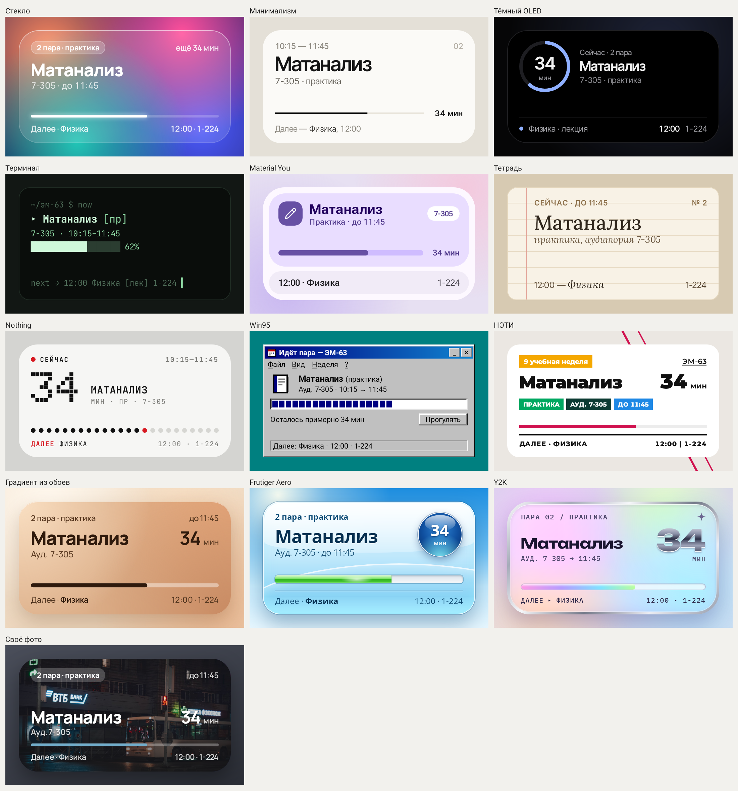

> ⚠️ **Неофициальный проект.** Приложение не связано с НГТУ НЭТИ, не одобрено университетом и не является частью YourNETI.
> Расписание берётся с публичной страницы [«Расписание занятий»](https://www.nstu.ru/studies/schedule/schedule_classes) на nstu.ru, вход в личный кабинет не нужен.
> Если что-то расходится с сайтом, верным считается сайт университета.

## Установка

1. Откройте на телефоне страницу [Releases](../../releases/latest).
2. В разделе **Assets** нажмите на файл `raspisanie-neti-vX.Y.Z.apk` — он скачается.
3. Откройте скачанный файл (из уведомления или из «Загрузок»).
4. Если Android скажет, что установка из этого источника запрещена, нажмите **«Настройки»** → включите **«Разрешить из этого источника»** → вернитесь назад.
   Обычно разрешение нужно дать браузеру (Chrome) или файловому менеджеру — один раз.
5. Нажмите **«Установить»**. Google Play Защита может предупредить о неизвестном приложении — нажмите «Всё равно установить»: приложение не из Play Маркета, поэтому оно ему незнакомо.
6. Откройте приложение и выберите свою группу.

**Обновление:** в приложении «Настройки» → «Проверить обновления» → «Скачать обновление», затем откройте файл и нажмите «Обновить». Настройки и виджеты сохранятся.

## Как добавить виджет

1. Долгое нажатие на пустом месте рабочего стола → **«Виджеты»**.
2. Найдите **«Расписание НЭТИ» → «Расписание пар»** и перетащите на экран.
3. Откроется настройка: группа (как в приложении или своя), подгруппа и стиль с живым превью → **«Готово»**.
4. Размер меняется долгим нажатием на виджет и перетаскиванием рамки.

Тап по виджету открывает расписание на сегодня и неделю. Чтобы перенастроить виджет, нажмите на него и затем на карандаш вверху (на Android 12+ можно и через долгое нажатие → «Настроить»).

## Стили

| | | |
|---|---|---|
| 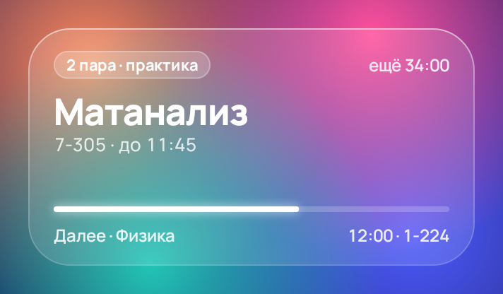 Стекло | 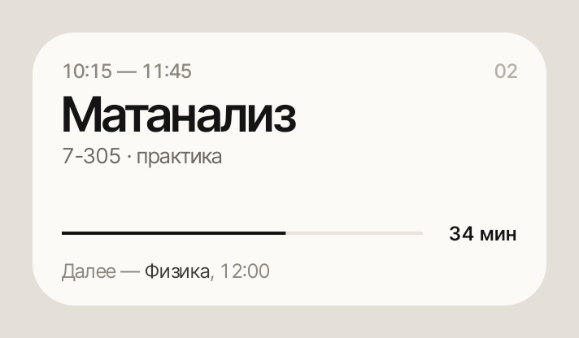 Минимализм | 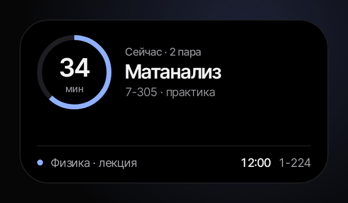 Тёмный OLED |
| 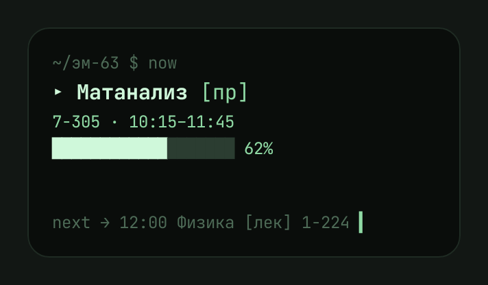 Терминал | 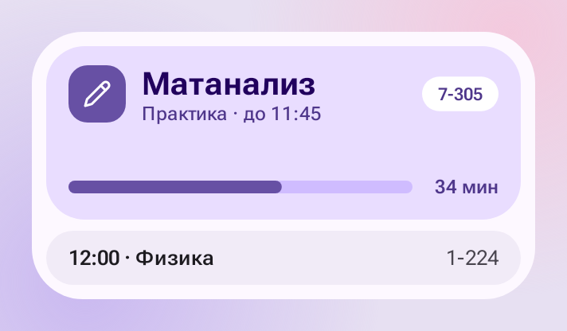 Material You | 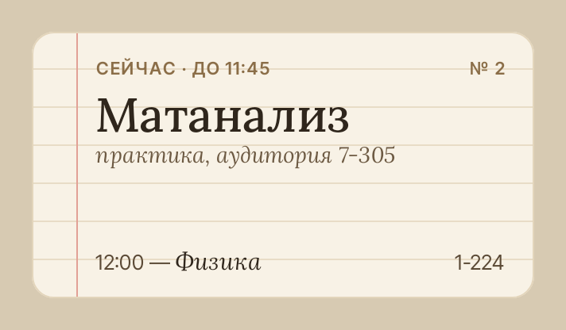 Тетрадь |
| 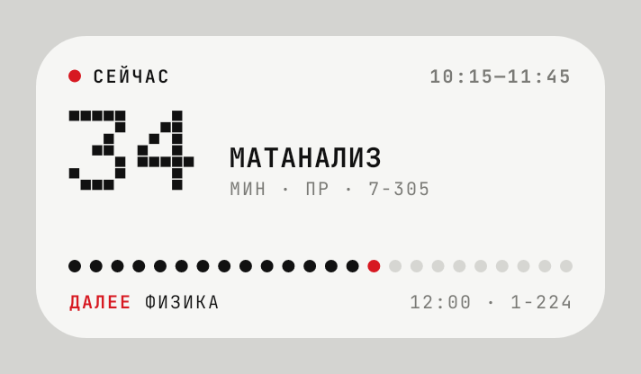 Nothing | 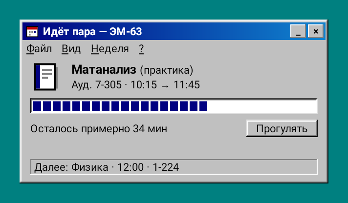 Win95 | 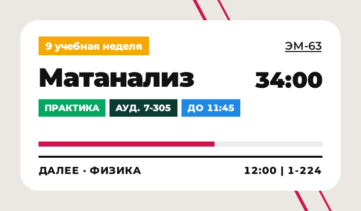 НЭТИ |
| 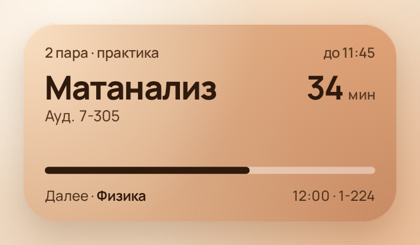 Градиент из обоев | 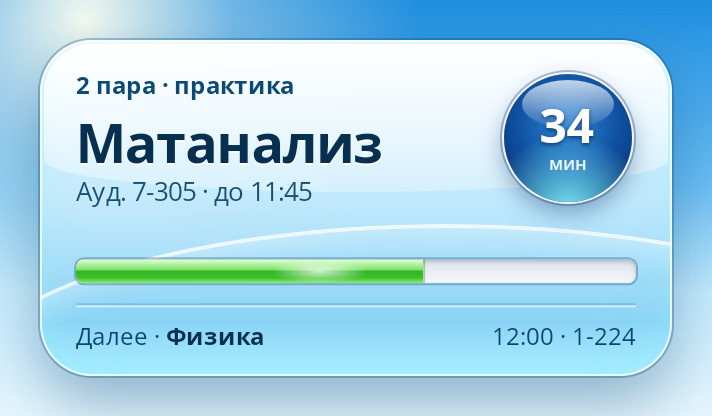 Frutiger Aero | 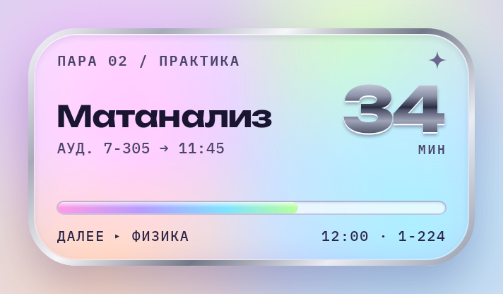 Y2K |
| 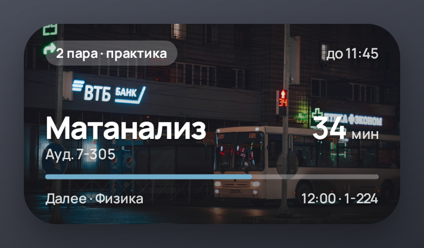 Своё фото: градиент | 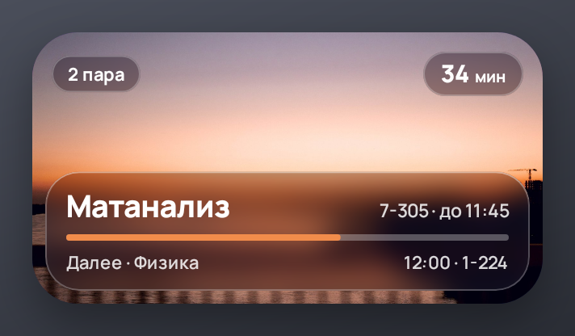 Своё фото: стекло | 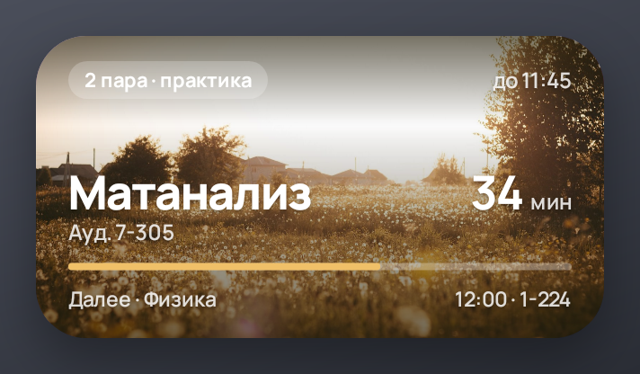 Своё фото: светлый снимок |

«Стекло» на рабочем столе лежит прямо на обоях — размытия обоев виджеты Android не умеют, поэтому стекло нарисовано имитацией. У «Своего фото» стекло настоящее: виджет размывает своё же фото.
«Material You» на Android 12+ берёт цвета из обоев.

## Как это работает

- **Данные.** Раз в сутки (только при наличии интернета) приложение скачивает две страницы на группу: «расписание на весь семестр» и текущую неделю — с неё берётся номер учебной недели. Новые данные заменяют старые, только если всё скачалось и разобралось; при ошибке виджет продолжает показывать сохранённое, а в приложении видно, когда было последнее обновление.
- **Время** всегда новосибирское, даже если на телефоне другой часовой пояс.
- **Чётность недель** не вычисляется «от 1 сентября», а берётся с сайта.
- **Батарея.** Виджет перерисовывается на границах пар и раз в минуту, пока идёт обратный отсчёт (не больше 90 минут до события). Будильники «не будящие»: при выключенном экране телефон не просыпается ради виджета, обновление происходит, когда экран включают.
- **Разрешения:** интернет, запуск после перезагрузки и точные будильники (чтобы виджет переключался ровно в момент начала и конца пары).
- **Приватность.** Никакой аналитики и сбора данных. Приложение обращается только к nstu.ru и к GitHub (проверка версий).

## Для разработчиков

Код живёт здесь, APK собирается в GitHub Actions — локально ничего ставить не нужно.

| Папка | Что внутри |
|---|---|
| `core/` | чистый Kotlin без Android: модель, парсер nstu.ru (jsoup), недели, состояния виджета, тексты; юнит-тесты на `samples/` |
| `app/` | Android: Glance-виджет, отрисовка стилей на Canvas (`render/`), экраны на Compose (`ui/`), сеть и кэш (`data/`), WorkManager (`work/`) |
| `samples/` | сохранённые страницы nstu.ru для тестов парсера; устройство страниц описано в [samples/README.md](samples/README.md) |
| `design/` | HTML-макет всех стилей — главный референс дизайна |

**Сборка.** На каждый push: тесты и отладочный APK (артефакт хранится 5 дней). Тест `ScreenshotTest` рисует все стили во всех состояниях; картинки и краткий лог попадают в служебную ветку `ci-logs`.

**Релиз.** Добавьте раздел в [CHANGELOG.md](CHANGELOG.md) и создайте тег `vX.Y.Z` — Actions соберёт подписанный APK и опубликует GitHub Release с описанием из CHANGELOG.

**Подпись.** APK всегда подписывается одним ключом, иначе обновление не установится поверх. Ключ хранится только в секретах репозитория (Settings → Secrets and variables → Actions):

- `SIGNING_KEYSTORE_BASE64` — keystore (PKCS12) в base64;
- `SIGNING_KEYSTORE_PASSWORD` — пароль; алиас ключа — `neti`.

**Стили.** Новый стиль — один JSON-файл в [`app/src/main/assets/themes/`](app/src/main/assets/themes), без правок кода. Схема, раскладки и как виджет подстраивается под размер — в [docs/STYLES.md](docs/STYLES.md).

## Лицензии

Код — [MIT](LICENSE). Шрифты Manrope, Inter Tight, JetBrains Mono, Roboto Flex, Lora, Doto, Montserrat — SIL Open Font License 1.1 (тексты лицензий в [`app/src/main/assets/licenses`](app/src/main/assets/licenses)). Иконки — [Lucide](https://lucide.dev) (ISC). Данные расписания принадлежат НГТУ НЭТИ.
