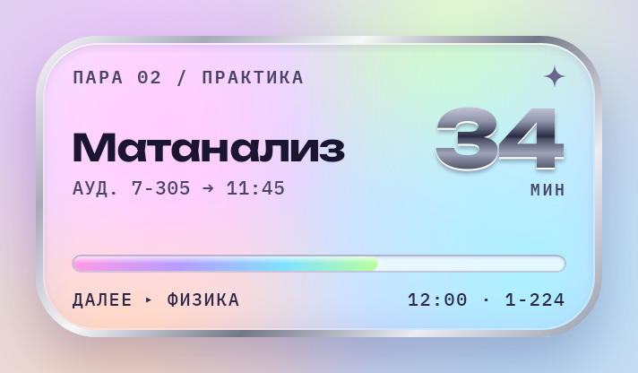

# Черновик стиля «Y2K»

Стиль убран из приложения 04.11.2026: в таком виде не понравился. Файлы лежат здесь, чтобы потом
его можно было доработать и вернуть.

- Макет — правая часть [`design/mockups/style-frutiger-aero-v2-and-y2k.html`](../../mockups/style-frutiger-aero-v2-and-y2k.html).
- [`y2k.json`](y2k.json) — сам стиль (раскладка `hero`).
- [`fonts/`](fonts) — Unbounded (название и хромовые цифры) и IBM Plex Mono Medium / SemiBold (мелкий текст),
  [`licenses/`](licenses) — их лицензии SIL OFL.

Что из движка он использует: хромовая рамка (`border.color` с градиентом), стекло внутри рамки (слой `shape`
с `backdropBlur`), хромовые цифры (`fill` у роли `counter` и две тени `shadows`), отсчёт справа по низу
(`counter.placement: side`, `valign: end`), звёздочка (иконка с `"fill": true`), полоса с рамкой внутри
(`progress.fillInset`). Всё это осталось в движке, описание — в `docs/STYLES.md`.

## Как вернуть

1. `y2k.json` → `app/src/main/assets/themes/`, шрифты → `app/src/main/res/font/`,
   лицензии → `app/src/main/assets/licenses/`.
2. Дописать Unbounded и IBM Plex Mono в список шрифтов в «О приложении» (`ui/SettingsScreen.kt`).
3. Добавить `y2k` в список стилей в `ThemeFilesTest` и в `ScreenshotTest.newStylesLikeTheMockups`.
